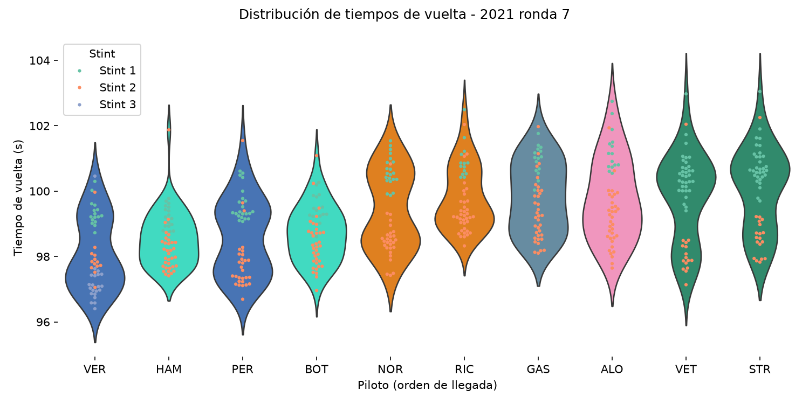
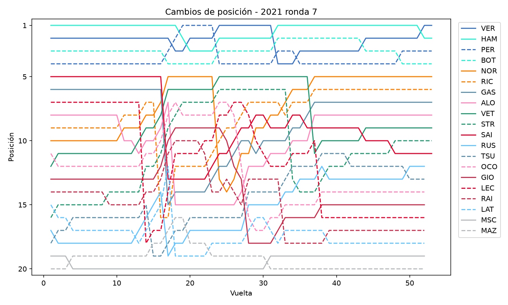
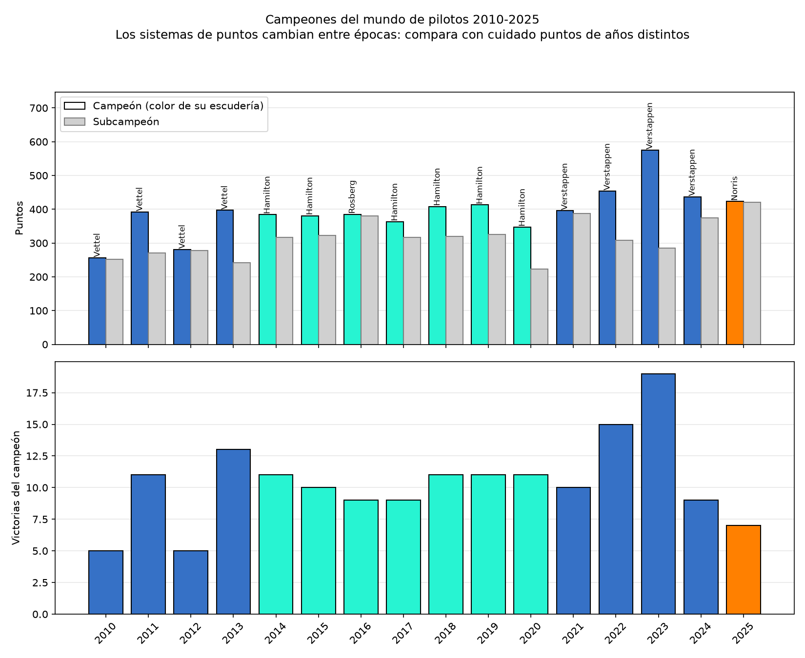

# F1-Analysis

Análisis de datos de Fórmula 1 con Python, a nivel de carrera (resultados, clasificación, tiempos por vuelta, ritmo, cambios de posición y estrategias), de temporada (quién puede ganar el campeonato, puntos por piloto y carrera) y entre temporadas (campeones año a año), usando [FastF1](https://docs.fastf1.dev/) y la API [Jolpica](https://github.com/jolpica/jolpica-f1) (compatible con Ergast).

Proyecto personal de aprendizaje en análisis de datos. Se construyó paso a paso a partir de la documentación de FastF1 (*Getting Started* y *Examples Gallery*), adaptando los ejemplos a datos abiertos, y se organizó en un paquete reutilizable con tres herramientas de línea de comandos.

## Gráficas

### Análisis de carrera

Ejemplo con el GP de Francia 2021 (`py src/main.py --season 2021 --round 7`).







### Análisis de temporada

Ejemplo con la temporada 2022 completa (`py src/main_season.py --season 2022 --round 22`).


También se genera un [resumen interactivo en HTML](outputs/season_summary_2022_r22.html): al pasar el ratón por cada celda se ve el piloto, la carrera, los puntos y la posición de llegada. GitHub no ejecuta archivos HTML, así que hay que descargarlo y abrirlo en el navegador.

### Comparativa entre temporadas

Ejemplo con los campeones de 2010 a 2025 (`py src/main_history.py --start 2010 --end 2025`).



## Qué hace

- Descarga resultados de clasificación y de carrera de cualquier temporada y ronda.
- Obtiene los tiempos de todas las vueltas y las paradas en boxes, y deduce los stints de cada piloto.
- Calcula la vuelta rápida y la mejor vuelta de cada piloto.
- Calcula qué pilotos pueden ganar aún el campeonato, contando carreras y sprints restantes.
- Construye la matriz de puntos por piloto y ronda (carrera más sprint) y comprueba que coincide con la clasificación oficial.
- Compara el campeón y el subcampeón de cada temporada en un rango de años.
- Genera gráficas estáticas (PNG) y un resumen interactivo (HTML), y las guarda en `outputs/` con la temporada y la ronda en el nombre.

## Datos y limitaciones

Los datos se obtienen de Jolpica a través de `fastf1.ergast`, por lo que **no hace falta ninguna cuenta**.

Desde octubre de 2026, Formula 1 exige autenticación (suscripción F1TV Access o superior) en sus APIs de datos, y FastF1 v3.9.0 lo refleja al cargar sesiones con `session.load()`. Este proyecto evita esa vía a propósito.

Las contrapartidas son:

- **No hay telemetría** (velocidad, freno, acelerador, posición en pista).
- **No hay compuesto de neumático** (blando, medio, duro). Como sustituto, las gráficas se colorean por **stint**, deducido de las paradas en boxes.
- **Límite de peticiones**: Jolpica responde `Too Many Requests` si se hacen demasiadas seguidas. Los análisis de temporada y de campeones reintentan con esperas crecientes, y FastF1 guarda lo ya descargado en caché, así que repetir el comando continúa donde se quedó.
- **Épocas distintas**: el sistema de puntos ha cambiado a lo largo de la historia, por lo que comparar puntos de años muy distantes no es directo. El cálculo de puntos máximos restantes usa el sistema actual.

## Instalación

Requiere Python 3.10 o superior.

```powershell
git clone https://github.com/LuisPV05/F1-Analysis.git
cd F1-Analysis
py -m venv .venv
.venv\Scripts\Activate.ps1
py -m pip install -r requirements.txt
```

## Uso

### Análisis de una carrera

```powershell
py src/main.py --season 2021 --round 7
```

| Opción | Descripción |
|---|---|
| `--season` | Año de la temporada (obligatorio) |
| `--round` | Número de ronda (obligatorio) |
| `--top` | Número de pilotos en la gráfica de ritmo (por defecto 4) |
| `--driver` | Código del piloto para la dispersión de vueltas, p. ej. `HAM` (por defecto, el ganador) |
| `--no-show` | Guarda las gráficas sin abrirlas en pantalla |

Muestra por consola la vuelta rápida y la mejor vuelta de cada piloto, y guarda siete gráficas en `outputs/`.

### Análisis de una temporada

```powershell
py src/main_season.py --season 2022 --round 22
```

| Opción | Descripción |
|---|---|
| `--season` | Año de la temporada (obligatorio) |
| `--round` | Ronda hasta la que se analiza (obligatorio) |
| `--no-show` | Guarda los archivos sin abrir las gráficas ni el HTML |

Muestra por consola la clasificación con el máximo teórico de puntos de cada piloto, y guarda dos PNG y un HTML interactivo en `outputs/`. Para ver pilotos descartados del título, usa una ronda tardía de una temporada en curso, por ejemplo `--season 2025 --round 21`.

### Comparativa de campeones

```powershell
py src/main_history.py --start 2010 --end 2025
```

| Opción | Descripción |
|---|---|
| `--start` | Primera temporada (obligatorio) |
| `--end` | Última temporada (obligatorio) |
| `--no-show` | Guarda la gráfica sin abrirla en pantalla |

Muestra por consola una tabla con el campeón, su escudería, sus puntos y victorias, y el margen sobre el subcampeón, y guarda una gráfica en `outputs/`. Se recomienda no empezar antes del año 2000: los sistemas de puntos eran muy distintos y las escuderías antiguas no tienen color asignado.

### Ejemplos de aprendizaje

La carpeta `examples/` contiene los primeros pasos del proyecto, scripts sencillos e independientes del paquete. Se ejecutan desde la raíz del repo:

```powershell
py examples/01_basics.py
```

## Estructura

```
F1-Analysis/
├── README.md
├── requirements.txt
├── .gitignore
├── examples/                     # primeros pasos de aprendizaje
│   ├── 01_basics.py              # sesiones y eventos
│   ├── 02_schedule.py            # calendario de temporada
│   ├── 03_results_ergast.py      # resultados con Jolpica
│   └── 04_laps_ergast.py         # exploración de tiempos por vuelta
├── outputs/                      # gráficas generadas
└── src/
    ├── main.py                   # línea de comandos: análisis de una carrera
    ├── main_season.py            # línea de comandos: análisis de una temporada
    ├── main_history.py           # línea de comandos: comparativa de campeones
    └── f1analysis/               # paquete con la lógica
        ├── data.py               # datos de carrera desde Jolpica
        ├── analysis.py           # cálculos de carrera: delta con la pole, vuelta rápida...
        ├── styling.py            # colores de escudería y estilo por piloto
        ├── plots.py              # gráficas de carrera (matplotlib y seaborn)
        ├── season.py             # clasificaciones, puntos y opciones al título
        ├── season_plots.py       # gráficas de temporada (seaborn y plotly)
        ├── history.py            # campeones de cada temporada
        └── history_plots.py      # gráfica de campeones entre temporadas
```

## Flujo de trabajo

Cada funcionalidad sigue el mismo ciclo en GitHub:

1. Se abre un **issue** que describe lo que hay que hacer.
2. Se trabaja en una **rama** propia (`feature/N-nombre`, `docs/N-nombre` o `refactor/N-nombre`).
3. Cada **commit** empieza por el número del issue: `#N feat: ...`.
4. Se abre un **pull request** cuya descripción incluye `Closes #N`.
5. Al hacer el merge, el issue se cierra solo y la rama se borra.

## Tecnologías

- Python
- FastF1 (módulo `fastf1.ergast`)
- pandas
- matplotlib
- seaborn
- plotly

## Próximos pasos

- [x] Reorganizar el código en módulos reutilizables.
- [x] Elegir temporada y ronda desde la línea de comandos.
- [x] Estilo por piloto con colores de escudería y leyenda ordenada.
- [x] Dispersión y distribución de tiempos de vuelta.
- [x] Estrategia y resultados: cambios de posición, ritmo por equipos y estrategia por stints.
- [x] Temporada: quién puede ganar el campeonato, mapa de calor de puntos y resumen interactivo.
- [x] Mover los scripts de ejemplo a una carpeta `examples/`.
- [x] Comparativa de campeones entre temporadas.
- [ ] Comparar dos pilotos concretos a lo largo de varias temporadas.
- [ ] Telemetría y mapa del circuito, si se dispone de acceso a los datos (requieren cuenta F1TV).

## Autor

Luis Pérez Velasco · [@LuisPV05](https://github.com/LuisPV05)