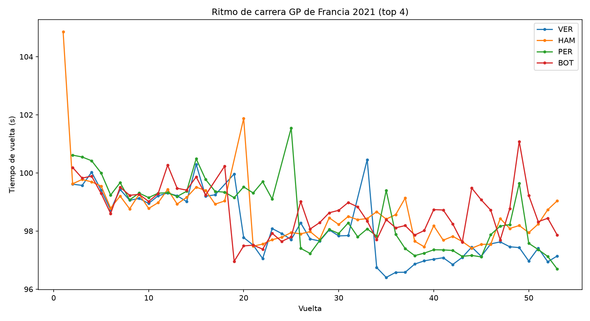

# F1-Analysis

Análisis de datos de Fórmula 1 con Python: resultados de carrera, clasificación, tiempos por vuelta y ritmo de carrera, usando [FastF1](https://docs.fastf1.dev/) y la API [Jolpica](https://github.com/jolpica/jolpica-f1) (compatible con Ergast).

Proyecto personal de aprendizaje en análisis de datos, construido paso a paso siguiendo la sección *Getting Started* de la documentación de FastF1.

## Gráficas

**Diferencia con la pole en clasificación (GP de Francia 2021)**


**Ritmo de carrera de los 4 primeros (GP de Francia 2021)**



## Qué hace

- Carga eventos, sesiones y calendarios de temporada.
- Obtiene los resultados de clasificación y carrera.
- Descarga los tiempos de todas las vueltas de una carrera (con paginación).
- Calcula la vuelta rápida y la mejor vuelta de cada piloto.
- Genera gráficas con matplotlib y las guarda en `outputs/`.

## Nota importante: cuenta F1TV

Desde octubre de 2026, Formula 1 exige autenticación (suscripción F1TV Access o superior) en sus APIs de datos, y FastF1 v3.9.0 lo refleja al cargar sesiones con `session.load()`.

Este proyecto **no necesita cuenta**: los datos de resultados y vueltas se obtienen de Jolpica a través de `fastf1.ergast`. La contrapartida es que **no hay telemetría** (velocidad, freno, acelerador).

El script `src/03_results.py` usa `session.load()` y solo funciona con cuenta F1TV. Se mantiene como referencia.

## Estructura

```
F1-Analysis/
├── README.md
├── requirements.txt
├── .gitignore
├── outputs/                    # gráficas generadas
└── src/
    ├── 01_basics.py            # sesiones y eventos
    ├── 02_schedule.py          # calendario de temporada
    ├── 03_results.py           # resultados con session.load() (requiere F1TV)
    ├── 03_results_ergast.py    # resultados con Jolpica (sin cuenta)
    ├── 04_laps_ergast.py       # exploración de tiempos por vuelta
    ├── 05_qualifying_plot.py   # gráfica de clasificación
    └── 06_laps_analysis.py     # vuelta rápida y ritmo de carrera
```

## Instalación

Requiere Python 3.10 o superior.

```powershell
git clone https://github.com/LuisPV05/F1-Analysis.git
cd F1-Analysis
py -m venv .venv
.venv\Scripts\Activate.ps1
py -m pip install -r requirements.txt
```

## Uso

Cada script se ejecuta de forma independiente desde la raíz del repo:

```powershell
py src/05_qualifying_plot.py
py src/06_laps_analysis.py
```

Las gráficas se guardan en `outputs/`.

## Tecnologías

- Python
- FastF1
- pandas
- matplotlib

## Próximos pasos

- [ ] Reorganizar el código en módulos reutilizables (carga de datos, análisis, gráficas).
- [ ] Elegir año, circuito y pilotos desde la línea de comandos.
- [ ] Análisis de estrategia: paradas en boxes por piloto.
- [ ] Comparativas entre temporadas.
- [ ] Telemetría, si se dispone de acceso a los datos.

## Autor

Luis Pérez Velasco · [@LuisPV05](https://github.com/LuisPV05)