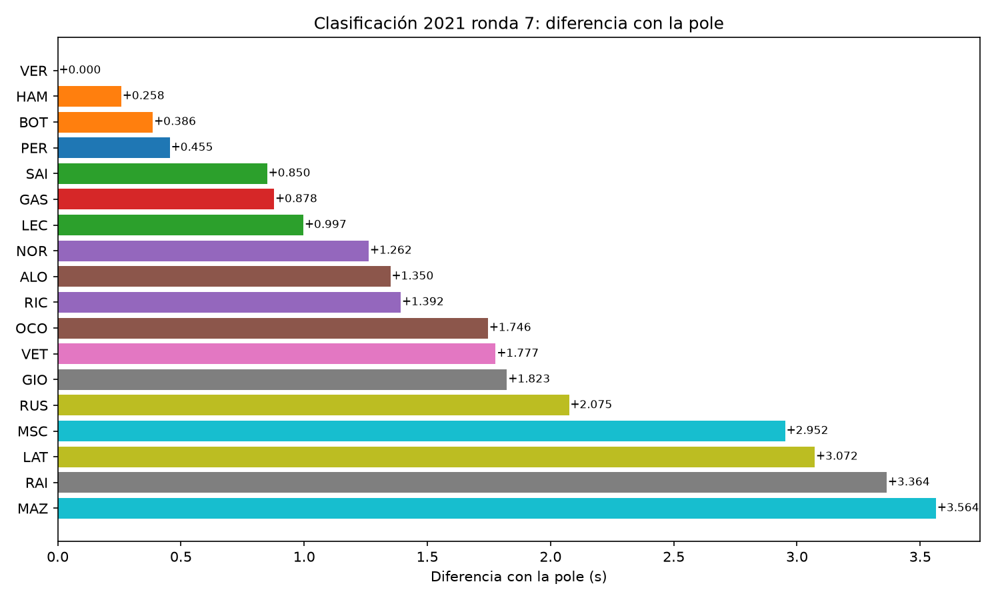

# F1-Analysis

Análisis de datos de Fórmula 1 con Python: resultados de carrera, clasificación, tiempos por vuelta, ritmo de carrera y distribución de tiempos, usando [FastF1](https://docs.fastf1.dev/) y la API [Jolpica](https://github.com/jolpica/jolpica-f1) (compatible con Ergast).

Proyecto personal de aprendizaje en análisis de datos. Se construyó paso a paso a partir de la documentación de FastF1 (*Getting Started* y *Examples Gallery*), adaptando los ejemplos a datos abiertos, y se reorganizó en un paquete reutilizable con una herramienta de línea de comandos.

## Gráficas

Ejemplo con el GP de Francia 2021 (`--season 2021 --round 7`).

**Diferencia con la pole en clasificación**



**Ritmo de carrera de los 4 primeros**


**Tiempos de vuelta de un piloto, coloreados por stint**


**Distribución de tiempos de vuelta de los 10 primeros**


## Qué hace

- Descarga resultados de clasificación y de carrera de cualquier temporada y ronda.
- Obtiene los tiempos de todas las vueltas y las paradas en boxes (con paginación de la API).
- Deduce los stints de cada piloto a partir de las paradas.
- Calcula la vuelta rápida y la mejor vuelta de cada piloto.
- Genera cuatro gráficas con matplotlib y seaborn, con colores de escudería, y las guarda en `outputs/` con la temporada y la ronda en el nombre.

## Datos y limitaciones

Los datos se obtienen de Jolpica a través de `fastf1.ergast`, por lo que **no hace falta ninguna cuenta**.

Desde octubre de 2026, Formula 1 exige autenticación (suscripción F1TV Access o superior) en sus APIs de datos, y FastF1 v3.9.0 lo refleja al cargar sesiones con `session.load()`. Este proyecto evita esa vía a propósito.

Las contrapartidas son:

- **No hay telemetría** (velocidad, freno, acelerador, posición en pista).
- **No hay compuesto de neumático** (blando, medio, duro). Como sustituto, las gráficas de tiempos de vuelta se colorean por **stint**, deducido de las paradas en boxes.

## Instalación

Requiere Python 3.10 o superior.

```powershell
git clone https://github.com/LuisPV05/F1-Analysis.git
cd F1-Analysis
py -m venv .venv
.venv\Scripts\Activate.ps1
py -m pip install -r requirements.txt
```

## Uso

Desde la raíz del repo:

```powershell
py src/main.py --season 2021 --round 7
```

Opciones:

| Opción | Descripción |
|---|---|
| `--season` | Año de la temporada (obligatorio) |
| `--round` | Número de ronda (obligatorio) |
| `--top` | Número de pilotos en la gráfica de ritmo (por defecto 4) |
| `--driver` | Código del piloto para la dispersión de vueltas, p. ej. `HAM` (por defecto, el ganador) |
| `--no-show` | Guarda las gráficas sin abrirlas en pantalla |

Ejemplo sin abrir ventanas:

```powershell
py src/main.py --season 2023 --round 1 --top 5 --driver ALO --no-show
```

El programa muestra por consola la vuelta rápida y la mejor vuelta de cada piloto, y guarda cuatro gráficas en `outputs/`.

## Estructura

```
F1-Analysis/
├── README.md
├── requirements.txt
├── .gitignore
├── outputs/                      # gráficas generadas
└── src/
    ├── main.py                   # herramienta de línea de comandos
    ├── f1analysis/               # paquete con la lógica
    │   ├── data.py               # descarga y limpieza de datos (Jolpica)
    │   ├── analysis.py           # cálculos: delta con la pole, vuelta rápida...
    │   ├── styling.py            # colores de escudería y estilo por piloto
    │   └── plots.py              # gráficas con matplotlib y seaborn
    ├── 01_basics.py              # ejemplo: sesiones y eventos
    ├── 02_schedule.py            # ejemplo: calendario de temporada
    ├── 03_results_ergast.py      # ejemplo: resultados con Jolpica
    └── 04_laps_ergast.py         # ejemplo: exploración de tiempos por vuelta
```

Los scripts numerados son los primeros pasos de aprendizaje y se conservan como ejemplos. La funcionalidad actual está en `src/main.py` y en el paquete `src/f1analysis/`.

## Tecnologías

- Python
- FastF1 (módulo `fastf1.ergast`)
- pandas
- matplotlib
- seaborn

## Próximos pasos

- [x] Reorganizar el código en módulos reutilizables (datos, análisis, gráficas).
- [x] Elegir temporada y ronda desde la línea de comandos.
- [x] Estilo por piloto con colores de escudería y leyenda ordenada.
- [x] Dispersión y distribución de tiempos de vuelta.
- [ ] Estrategia y resultados: cambios de posición durante la carrera, ritmo por equipos y estrategia por stints.
- [ ] Clasificaciones de pilotos y constructores durante la temporada.
- [ ] Mover los scripts de ejemplo a una carpeta `examples/`.
- [ ] Comparativas entre temporadas.
- [ ] Mapa del circuito y telemetría, si se dispone de acceso a los datos (requieren cuenta F1TV).

## Autor

Luis Pérez Velasco · [@LuisPV05](https://github.com/LuisPV05)