# F1-Analysis

[](https://github.com/LuisPV05/F1-Analysis/actions/workflows/tests.yml)

Análisis de datos de Fórmula 1 con Python, a nivel de carrera (resultados, clasificación, tiempos por vuelta, ritmo, cambios de posición y estrategias), de temporada (quién puede ganar el campeonato, puntos por piloto y carrera, duelos entre compañeros de equipo y campeonato de constructores) y entre temporadas (campeones y comparación de pilotos año a año), usando [FastF1](https://docs.fastf1.dev/) y la API [Jolpica](https://github.com/jolpica/jolpica-f1) (compatible con Ergast).

Proyecto personal de aprendizaje en análisis de datos. Se construyó paso a paso a partir de la documentación de FastF1 (*Getting Started* y *Examples Gallery*), adaptando los ejemplos a datos abiertos, y se organizó en un paquete reutilizable con seis herramientas de línea de comandos, caché en disco, tests automáticos e integración continua.

## Gráficas

### Análisis de carrera

Ejemplo con el GP de Francia 2021 (`py src/main.py --season 2021 --round 7`).


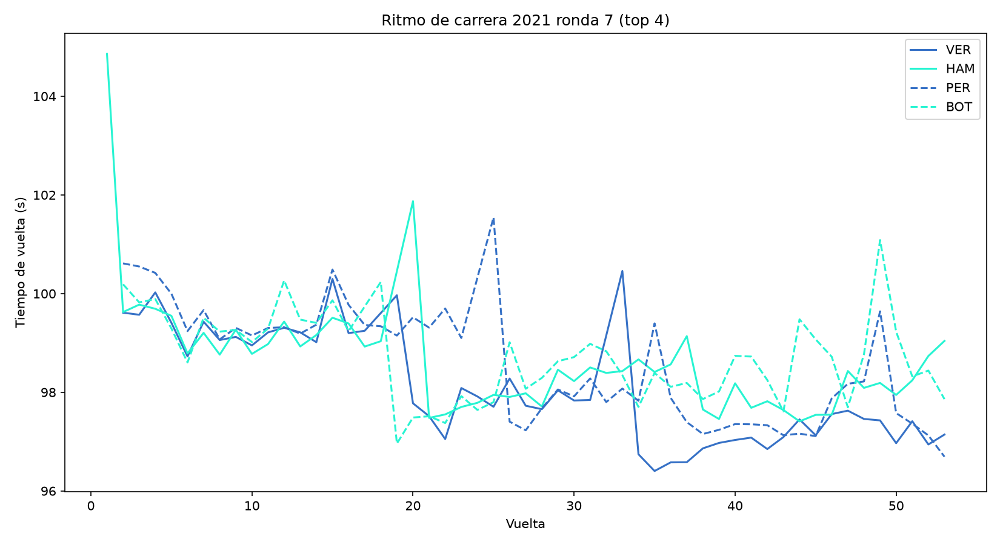

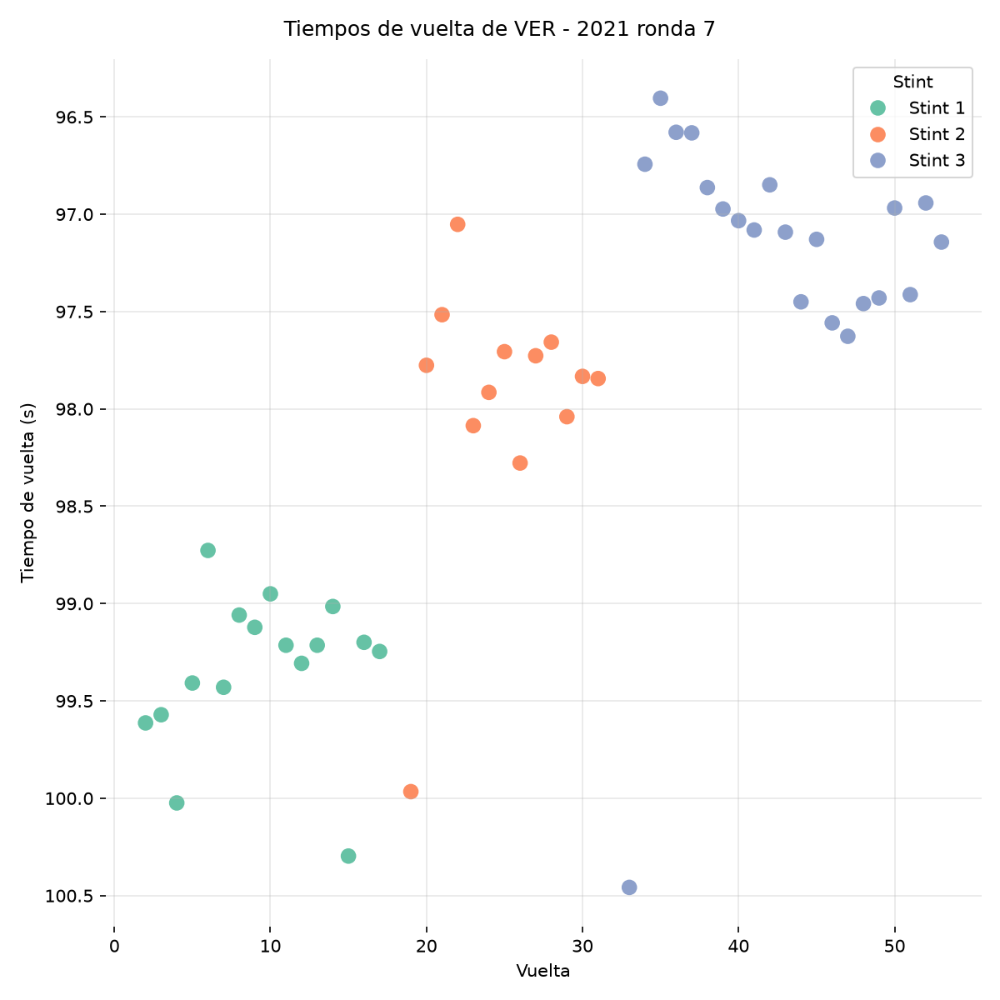


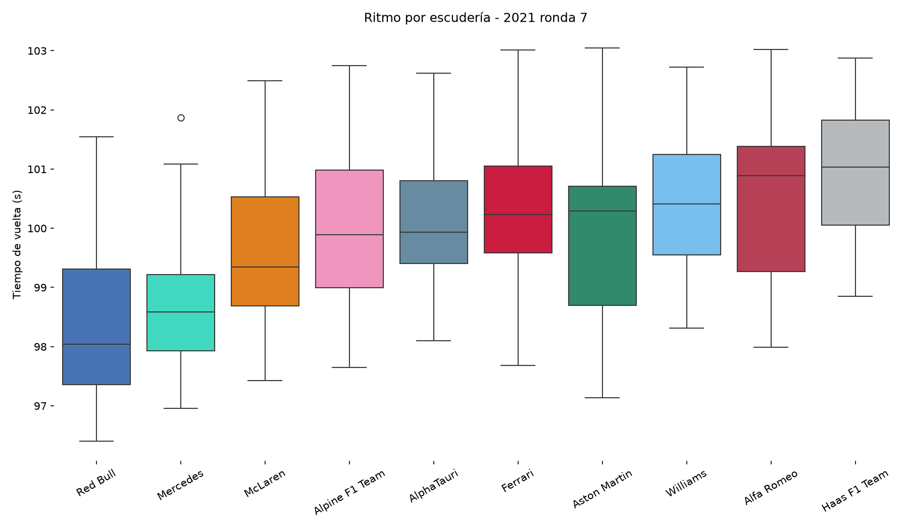

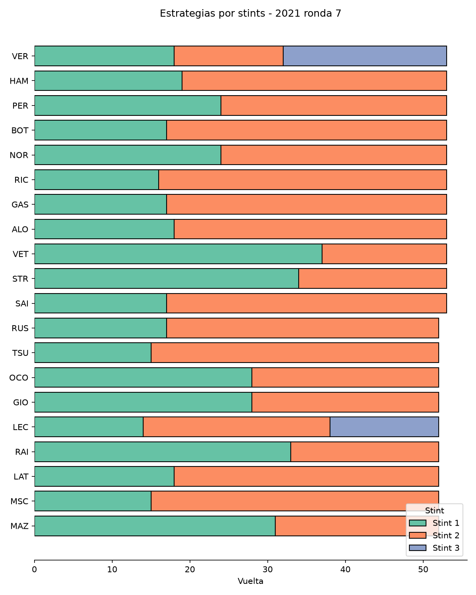

### Análisis de temporada

Ejemplo con la temporada 2022 completa (`py src/main_season.py --season 2022 --round 22`).

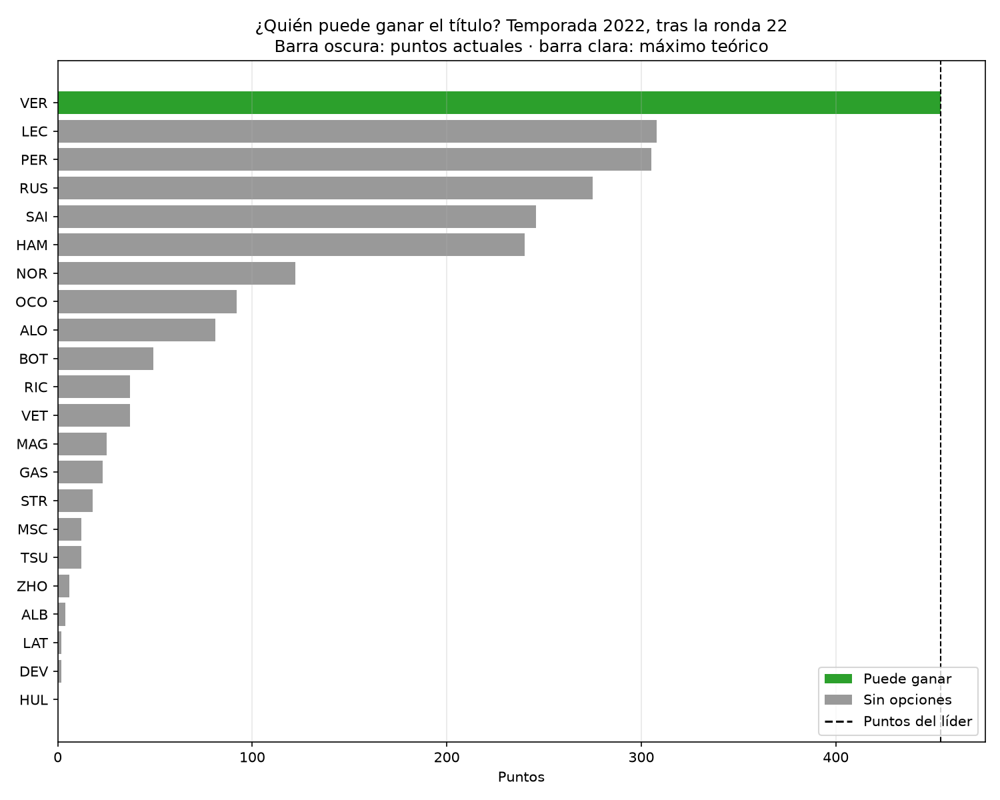

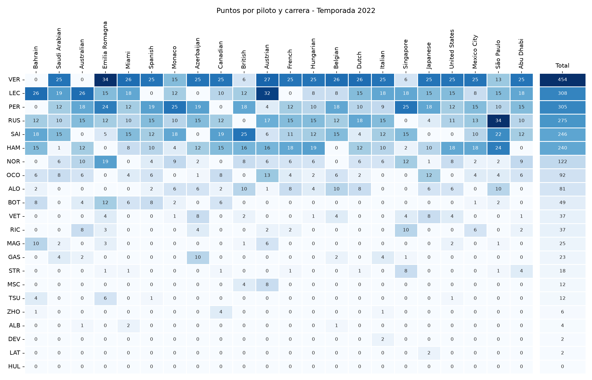

También se genera un [resumen interactivo en HTML](outputs/season_summary_2022_r22.html): al pasar el ratón por cada celda se ve el piloto, la carrera, los puntos y la posición de llegada. GitHub no ejecuta archivos HTML, así que hay que descargarlo y abrirlo en el navegador.

### Duelos entre compañeros de equipo

Temporada 2023 completa (`py src/main_teammates.py --season 2023`). Cada barra se reparte entre los dos pilotos de una escudería según quién acaba por delante en clasificación y en carrera.

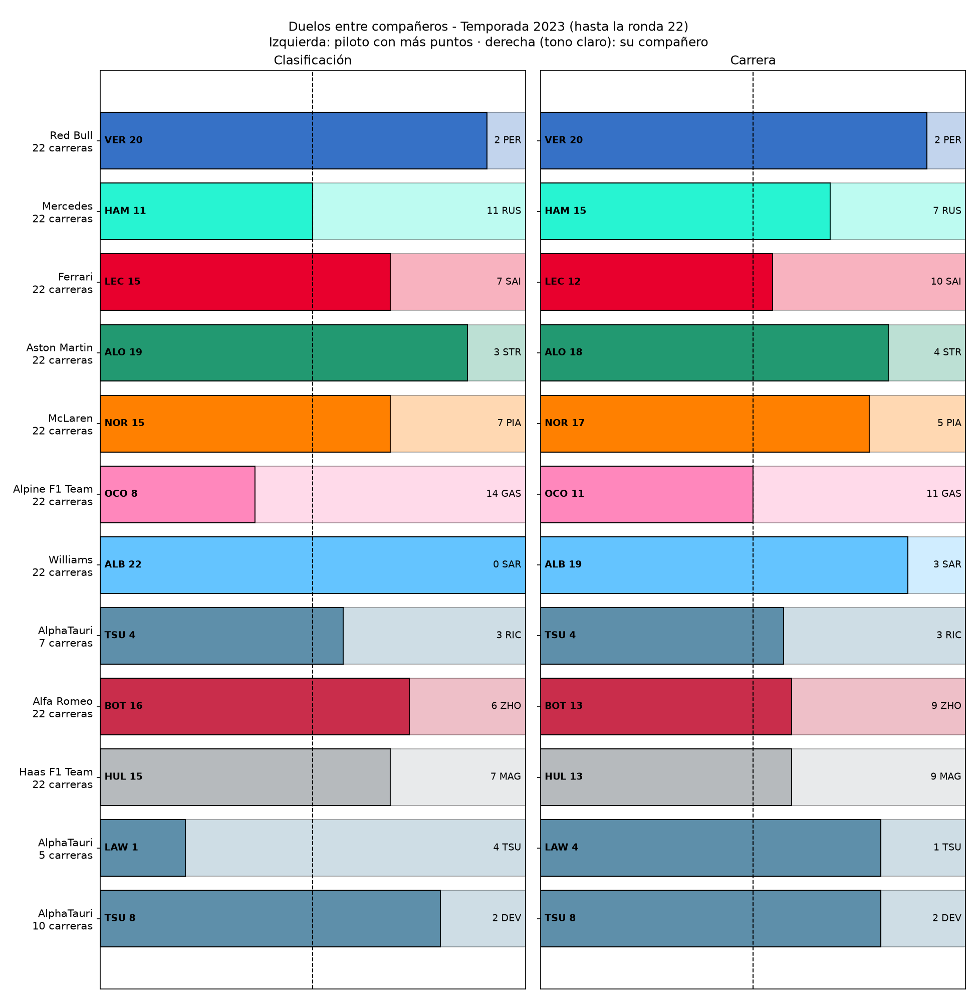

### Campeonato de constructores

Temporada 2023 completa (`py src/main_constructors.py --season 2023 --round 22`).

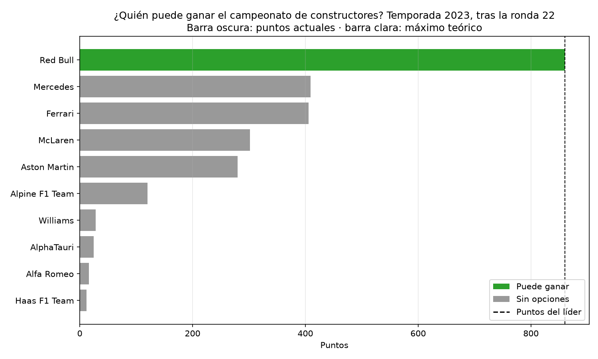

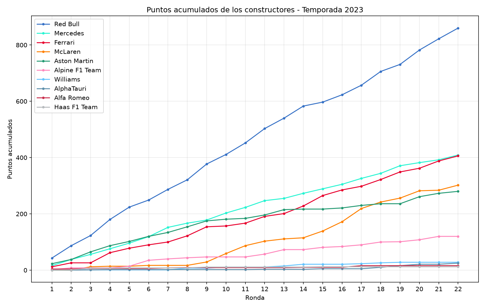

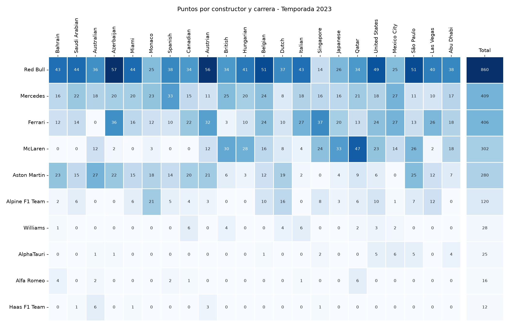

### Comparativas entre temporadas

Campeones de 2010 a 2025 (`py src/main_history.py --start 2010 --end 2025`).


Hamilton frente a Verstappen, de 2010 a 2025 (`py src/main_drivers.py --start 2010 --end 2025`). Las estrellas marcan los años en que cada piloto ganó el título.

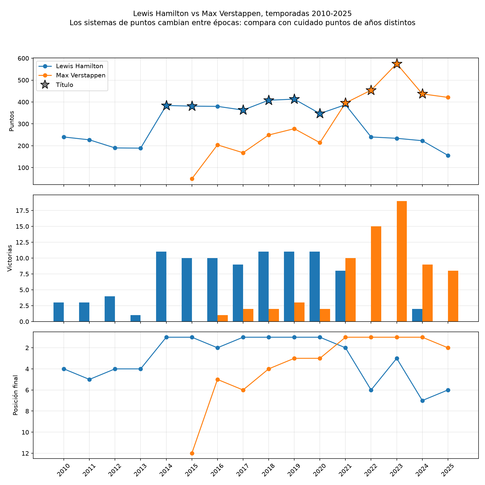

## Qué hace

- Descarga resultados de clasificación y de carrera de cualquier temporada y ronda.
- Obtiene los tiempos de todas las vueltas y las paradas en boxes, y deduce los stints de cada piloto.
- Calcula la vuelta rápida y la mejor vuelta de cada piloto.
- Calcula qué pilotos y qué escuderías pueden ganar aún el campeonato, contando carreras y sprints restantes.
- Construye la matriz de puntos por piloto y ronda (carrera más sprint) y comprueba que coincide con la clasificación oficial.
- Compara a los dos pilotos de cada escudería, fin de semana a fin de semana, en clasificación, carrera y puntos.
- Sigue la evolución de los puntos de cada constructor a lo largo de la temporada.
- Compara el campeón y el subcampeón de cada temporada en un rango de años.
- Compara los puntos, las victorias y la posición final de los pilotos que elijas a lo largo de varias temporadas.
- Guarda en disco los datos ya descargados, para repetir un análisis al instante y sin conexión.
- Genera gráficas estáticas (PNG) y un resumen interactivo (HTML), y las guarda en `outputs/` con la temporada y la ronda en el nombre.

## Datos y limitaciones

Los datos se obtienen de Jolpica a través de `fastf1.ergast`, por lo que **no hace falta ninguna cuenta**.

Desde octubre de 2026, Formula 1 exige autenticación (suscripción F1TV Access o superior) en sus APIs de datos, y FastF1 v3.9.0 lo refleja al cargar sesiones con `session.load()`. Este proyecto evita esa vía a propósito.

Las contrapartidas son:

- **No hay telemetría** (velocidad, freno, acelerador, posición en pista).
- **No hay compuesto de neumático** (blando, medio, duro). Como sustituto, las gráficas se colorean por **stint**, deducido de las paradas en boxes.
- **Límite de peticiones y respuestas lentas**: Jolpica responde `Too Many Requests` si se hacen demasiadas seguidas, y a veces tarda en contestar. Las peticiones esperan hasta 20 segundos y se reintentan con esperas crecientes ante límites de uso, tiempos de espera agotados y conexiones cortadas. La caché en disco evita repetir lo ya descargado, así que volver a lanzar un comando continúa donde se quedó.
- **Fallos de red**: un error de certificado o de conexión no se reintenta, porque no se arregla solo. Suele ser un problema temporal de la red: conviene reintentar más tarde o desde otra conexión.
- **Épocas distintas**: el sistema de puntos ha cambiado a lo largo de la historia, por lo que comparar puntos de años muy distantes no es directo. Los cálculos de puntos máximos restantes usan el sistema actual.

## Caché en disco

Los datos procesados de cada carrera, temporada y clasificación se guardan en la carpeta `.cache/` (ignorada por git):

- Las **temporadas terminadas** se guardan para siempre, porque no cambian.
- Los datos del **año en curso** caducan a las 12 horas, porque pueden aparecer carreras nuevas.
- Para **desactivarla** en una ejecución, define la variable de entorno `F1ANALYSIS_NO_CACHE=1` (en PowerShell, `$env:F1ANALYSIS_NO_CACHE=1`).
- Para **vaciarla**, borra la carpeta `.cache/`.

Los archivos usan pickle, por lo que es una caché estrictamente local: no cargues una procedente de una fuente en la que no confíes.

## Instalación

Requiere Python 3.10 o superior.

```powershell
git clone https://github.com/LuisPV05/F1-Analysis.git
cd F1-Analysis
py -m venv .venv
.venv\Scripts\Activate.ps1
py -m pip install -r requirements.txt
```

## Uso

### Análisis de una carrera

```powershell
py src/main.py --season 2021 --round 7
```

| Opción | Descripción |
|---|---|
| `--season` | Año de la temporada (obligatorio) |
| `--round` | Número de ronda (obligatorio) |
| `--top` | Número de pilotos en la gráfica de ritmo (por defecto 4) |
| `--driver` | Código del piloto para la dispersión de vueltas, p. ej. `HAM` (por defecto, el ganador) |
| `--no-show` | Guarda las gráficas sin abrirlas en pantalla |

Muestra por consola la vuelta rápida y la mejor vuelta de cada piloto, y guarda siete gráficas en `outputs/`.

### Análisis de una temporada

```powershell
py src/main_season.py --season 2022 --round 22
```

| Opción | Descripción |
|---|---|
| `--season` | Año de la temporada (obligatorio) |
| `--round` | Ronda hasta la que se analiza (obligatorio) |
| `--no-show` | Guarda los archivos sin abrir las gráficas ni el HTML |

Muestra por consola la clasificación con el máximo teórico de puntos de cada piloto, y guarda dos PNG y un HTML interactivo en `outputs/`. Para ver pilotos descartados del título, usa una ronda tardía de una temporada en curso, por ejemplo `--season 2025 --round 21`.

### Duelos entre compañeros de equipo

```powershell
py src/main_teammates.py --season 2023
py src/main_teammates.py --season 2025 --round 12 --no-show
```

| Opción | Descripción |
|---|---|
| `--season` | Año de la temporada (obligatorio) |
| `--round` | Ronda hasta la que se analiza (por defecto, toda la temporada) |
| `--no-show` | Guarda la gráfica sin abrirla en pantalla |

Muestra por consola una tabla con una fila por pareja de pilotos (carreras juntos, victorias en clasificación y en carrera, y puntos) y guarda una gráfica en `outputs/`. Solo se cuentan las carreras en las que los dos coincidieron, y si una escudería cambia de piloto a mitad de año aparece con varias parejas. En carrera, un abandono queda por detrás de quien termina, según la clasificación oficial, y los puntos no incluyen los sprints.

### Campeonato de constructores

```powershell
py src/main_constructors.py --season 2023 --round 22
```

| Opción | Descripción |
|---|---|
| `--season` | Año de la temporada (obligatorio) |
| `--round` | Ronda hasta la que se analiza (obligatorio) |
| `--no-show` | Guarda las gráficas sin abrirlas en pantalla |

Muestra por consola la clasificación de constructores con el máximo teórico de puntos de cada equipo (43 por carrera y 15 por sprint) y guarda tres gráficas en `outputs/`: opciones al título, evolución de los puntos acumulados y mapa de calor de puntos por carrera.

### Comparativa de campeones

```powershell
py src/main_history.py --start 2010 --end 2025
```

| Opción | Descripción |
|---|---|
| `--start` | Primera temporada (obligatorio) |
| `--end` | Última temporada (obligatorio) |
| `--no-show` | Guarda la gráfica sin abrirla en pantalla |

Muestra por consola una tabla con el campeón, su escudería, sus puntos y victorias, y el margen sobre el subcampeón, y guarda una gráfica en `outputs/`. Se recomienda no empezar antes del año 2000: los sistemas de puntos eran muy distintos y las escuderías antiguas no tienen color asignado.

### Comparativa de pilotos

```powershell
py src/main_drivers.py --start 2010 --end 2025
py src/main_drivers.py --start 2005 --end 2018 --drivers alonso vettel
```

| Opción | Descripción |
|---|---|
| `--start` | Primera temporada (obligatorio) |
| `--end` | Última temporada (obligatorio) |
| `--drivers` | Dos o más pilotos, por identificador de Jolpica, código o apellido (por defecto `hamilton max_verstappen`) |
| `--no-show` | Guarda la gráfica sin abrirla en pantalla |

Muestra por consola un resumen (temporadas, títulos, victorias y puntos) y los puntos de cada piloto por año, y guarda una gráfica con puntos, victorias y posición final. Cuando el apellido pueda confundirse con otro piloto, conviene usar el identificador de Jolpica (`max_verstappen` en lugar de `verstappen`).

### Ejemplos de aprendizaje

La carpeta `examples/` contiene los primeros pasos del proyecto, scripts sencillos e independientes del paquete. Se ejecutan desde la raíz del repo:

```powershell
py examples/01_basics.py
```

## Desarrollo

Para trabajar en el proyecto se instalan también las dependencias de desarrollo y se ejecutan los tests:

```powershell
py -m pip install -r requirements-dev.txt
py -m pytest -v
```

Los tests (carpeta `tests/`) cubren las funciones que no dependen de la red: conversión de tiempos, stints, cálculos de carrera, estilos por piloto, búsqueda de pilotos, opciones al título, duelos entre compañeros, campeonato de constructores, calendario, reintentos y caché en disco. Usan datos inventados y una carpeta temporal, así que no hacen peticiones a Jolpica ni tocan `.cache/`.

### Integración continua

El workflow de GitHub Actions `.github/workflows/tests.yml` ejecuta los tests en cada pull request y en cada push a `main`, con Python 3.10 (el mínimo que exige FastF1) y 3.14. El estado aparece en la insignia de arriba y en los checks de cada PR.

## Estructura

```
F1-Analysis/
├── .github/
│   └── workflows/
│       └── tests.yml             # integración continua con pytest
├── examples/                     # primeros pasos de aprendizaje
│   ├── 01_basics.py              # sesiones y eventos
│   ├── 02_schedule.py            # calendario de temporada
│   ├── 03_results_ergast.py      # resultados con Jolpica
│   └── 04_laps_ergast.py         # exploración de tiempos por vuelta
├── outputs/                      # gráficas generadas
├── src/
│   ├── main.py                   # línea de comandos: análisis de una carrera
│   ├── main_season.py            # línea de comandos: análisis de una temporada
│   ├── main_teammates.py         # línea de comandos: duelos entre compañeros
│   ├── main_constructors.py      # línea de comandos: campeonato de constructores
│   ├── main_history.py           # línea de comandos: comparativa de campeones
│   ├── main_drivers.py           # línea de comandos: comparativa de pilotos
│   └── f1analysis/               # paquete con la lógica
│       ├── cache.py              # caché en disco de los datos de Jolpica
│       ├── data.py               # datos de carrera desde Jolpica, con reintentos
│       ├── analysis.py           # cálculos de carrera: delta con la pole, vuelta rápida...
│       ├── styling.py            # colores de escudería y estilo por piloto
│       ├── plots.py              # gráficas de carrera (matplotlib y seaborn)
│       ├── season.py             # calendario, clasificaciones, puntos y opciones al título
│       ├── season_plots.py       # gráficas de temporada (seaborn y plotly)
│       ├── teammates.py          # duelos entre compañeros de equipo
│       ├── teammates_plots.py    # gráfica de duelos
│       ├── constructors.py       # campeonato de constructores
│       ├── constructors_plots.py # gráficas del campeonato de constructores
│       ├── history.py            # campeones y comparación de pilotos por temporada
│       └── history_plots.py      # gráficas entre temporadas
├── tests/                        # tests con pytest
│   ├── test_analysis.py
│   ├── test_cache.py
│   ├── test_constructors.py
│   ├── test_data.py
│   ├── test_history.py
│   ├── test_schedule.py
│   ├── test_season.py
│   ├── test_styling.py
│   └── test_teammates.py
├── LICENSE
├── pytest.ini
├── requirements.txt
├── requirements-dev.txt
├── .gitignore
└── README.md
```

## Flujo de trabajo

Cada funcionalidad sigue el mismo ciclo en GitHub:

1. Se abre un **issue** que describe lo que hay que hacer.
2. Se trabaja en una **rama** propia (`feature/N-nombre`, `docs/N-nombre` o `refactor/N-nombre`).
3. Cada **commit** empieza por el número del issue: `#N feat: ...`.
4. Se abre un **pull request** cuya descripción incluye `Closes #N`, y los tests se ejecutan solos en GitHub Actions.
5. Al hacer el merge, el issue se cierra solo y la rama se borra.

## Tecnologías

- Python
- FastF1 (módulo `fastf1.ergast`)
- pandas
- matplotlib
- seaborn
- plotly
- pytest
- GitHub Actions

## Próximos pasos

- [x] Reorganizar el código en módulos reutilizables.
- [x] Elegir temporada y ronda desde la línea de comandos.
- [x] Estilo por piloto con colores de escudería y leyenda ordenada.
- [x] Dispersión y distribución de tiempos de vuelta.
- [x] Estrategia y resultados: cambios de posición, ritmo por equipos y estrategia por stints.
- [x] Temporada: quién puede ganar el campeonato, mapa de calor de puntos y resumen interactivo.
- [x] Mover los scripts de ejemplo a una carpeta `examples/`.
- [x] Comparativa de campeones entre temporadas.
- [x] Comparar pilotos a lo largo de varias temporadas.
- [x] Caché en disco de los datos de Jolpica.
- [x] Tests con pytest e integración continua con GitHub Actions.
- [x] Duelos entre compañeros de equipo y campeonato de constructores.
- [ ] Modelo predictivo de la posición final.
- [ ] Dashboard interactivo con Streamlit.
- [ ] Telemetría y mapa del circuito, si se dispone de acceso a los datos (requieren cuenta F1TV).

## Licencia

Consulta el archivo [LICENSE](LICENSE).

## Autor

Luis Pérez Velasco · [@LuisPV05](https://github.com/LuisPV05)